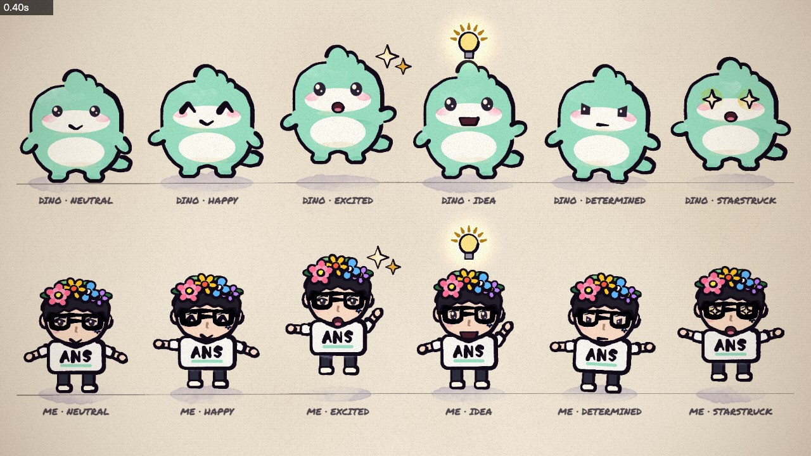
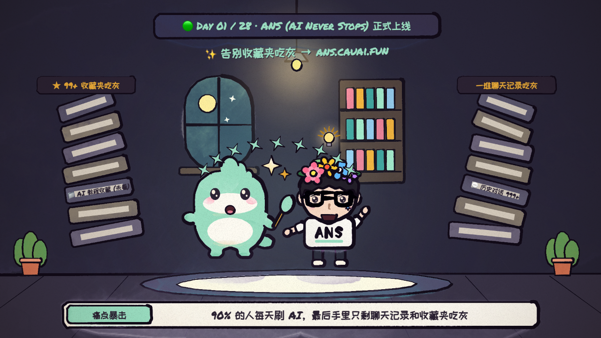
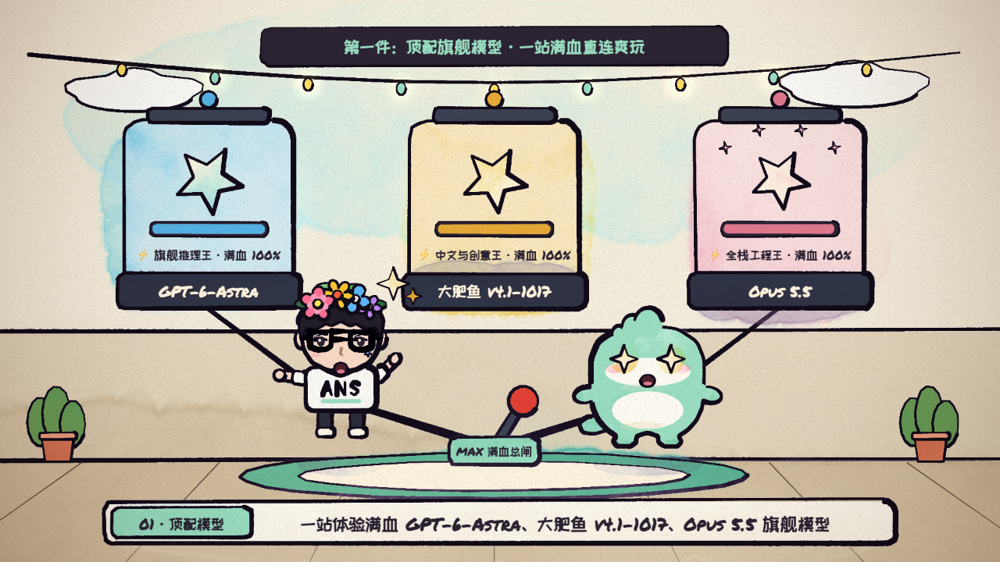
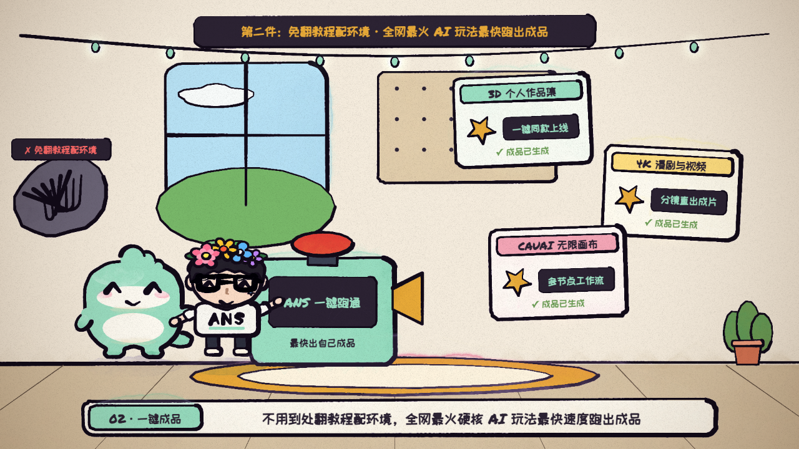
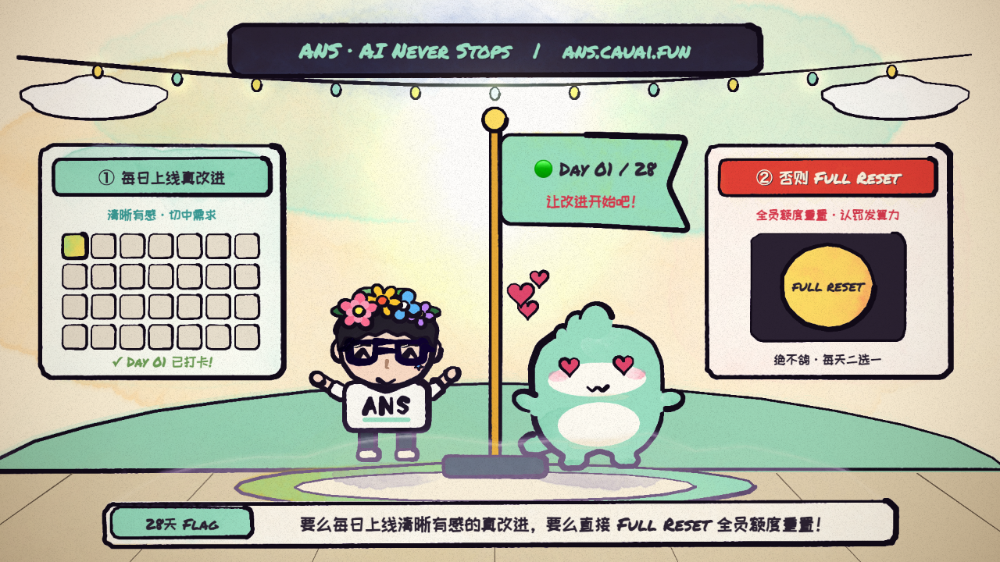

# ANS-Day01-P5Brush-Skill-Workflow-Handoff

🟢 ANS (AI Never Stops) · 手绘水彩双主角动画（p5.js + p5.brush V4.6 定稿）复利 Skill、工作流与跨电脑交接文档

> **版本**：V2 复利归档复核版（2026-10-20） · **本文件即飞书云文档的版本化源稿**（可直接重新导入飞书生成新版在线文档）
> **V2 飞书在线文档（本文档当前在线版）**：https://narcb9vct6.feishu.cn/wiki/EaHAwTrKQiwR4akgb9OcTZi3nAh
> **V1 飞书在线文档（初版）**：https://narcb9vct6.feishu.cn/wiki/EcBsw9QWzigqIVkBQnKcf8sQnvb
> **品牌铁律**：ANS 的唯一官方全称是 **AI Never Stops**（主站 https://ans.cauai.fun），严禁误写为 AI Native Society / AI Native Studio。

---

## 〇、 复利资产索引（换电脑先看这一张表）

| 资产 | 归档位置 | 状态 |
| :--- | :--- | :--- |
| 跨电脑复利总仓（V4.6 工程 + 关键帧素材 + 复利 Skill） | GitHub `1008611-creater/ans-brand-film-studio` 分支 `main`（V4.6 基线提交 `69d5887`） | ✅ 已推送并核对 |
| 手绘动画工程 | 仓库内 `ClaudeAnimationBase/`（src/ans_chars.js、src/scenes/ans_day01.js、src/sheets.js、STORYBOARD.md、render.mjs） | ✅ 已入库 |
| 定稿素材 | `ClaudeAnimationBase/out/check/ans_chars_sheet.jpg`（双主角 6 态设定图）+ `ClaudeAnimationBase/out/ans_day01_stills/t*.png`（5 幕 720p 关键帧） | ✅ 已入库 |
| 专属复利 Skill | 仓库内 `.agents/skills/ans-p5-brush-cartoon-animation/`（SKILL.md + scripts/ + references/，共 12 个文件） | ✅ 已入库 |
| ANS 主站仓库 Skill 备份 | GitHub `1008611-creater/ans-platform` 分支 `feat/dev3-ans-skill-refactor`（提交 `cbfad813`）路径 `ai-video-skills-source/ans-p5-brush-cartoon-animation/` | ✅ 已推送，与总仓 12 个文件逐一 blob 校验一致 |
| 飞书在线云文档 | V2（当前版）：https://narcb9vct6.feishu.cn/wiki/EaHAwTrKQiwR4akgb9OcTZi3nAh ｜ V1（初版）：https://narcb9vct6.feishu.cn/wiki/EcBsw9QWzigqIVkBQnKcf8sQnvb （均含内嵌高清设定图与 5 幕关键帧） | ✅ 已上传并回读核对 |
| 本机工作区 Skill（可被 Agent 自动发现） | `<仓库>/\.agents/skills/ans-p5-brush-cartoon-animation/` | ✅ 打开该仓库即为工作区即可自动加载 |
| 本机全局 Skill（Gemini / Codex 双端） | `~/.gemini/config/skills/ans-p5-brush-cartoon-animation/`、`~/.codex/skills/ans-p5-brush-cartoon-animation/` | ✅ 已安装（各 12 个文件，SHA256 与仓库一致） |
| 跨电脑便携压缩包（离线可用，含工程 + 素材 + Skill） | `C:\Users\lsb\Downloads\ans-p5-brush-cartoon-v46-portable-kit.zip`（约 30 MB） | ✅ 已生成并逐项核对 |

---

## 一、 核心交付总览与 GitHub / 本地归档位置

### 1. GitHub 跨电脑复利总仓（含完整 ClaudeAnimationBase 工程 + 关键帧素材 + 复利 Skill）
- 仓库地址：https://github.com/1008611-creater/ans-brand-film-studio （分支：`main`，V4.6 基线提交：`69d5887`）
- 手绘动画工程目录：`ClaudeAnimationBase/`（`src/ans_chars.js`、`src/scenes/ans_day01.js`、`src/sheets.js`、`STORYBOARD.md`、`render.mjs`、`out/check/ans_chars_sheet.jpg`、`out/ans_day01_stills/t*.png`）
- 专属复利 Skill 目录：`.agents/skills/ans-p5-brush-cartoon-animation/`
- 交接文档：`README.md`（跨电脑恢复指南）、`HANDOFF-PROMPT.md`（无缝续写提示词）、本文件 `ANS-Day01-P5Brush-Skill-Workflow-Handoff.md`（飞书源稿）

### 2. ANS 主站仓库（ans-platform）Skill 备份
- 仓库地址：https://github.com/1008611-creater/ans-platform （分支：`feat/dev3-ans-skill-refactor`，最新提交以远端分支为准）
- Skill 归档路径：`ai-video-skills-source/ans-p5-brush-cartoon-animation/`（SKILL.md、scripts/*、references/*）

### 3. 本机多端 Skill 同步路径与便携压缩包（Windows 实机核对）
- 工作区 Skill：`<仓库根>/\.agents/skills/ans-p5-brush-cartoon-animation/SKILL.md`
- 全局 Gemini Skill：`C:\Users\lsb\.gemini\config\skills\ans-p5-brush-cartoon-animation\`
- 全局 Codex Skill：`C:\Users\lsb\.codex\skills\ans-p5-brush-cartoon-animation\`
- 跨电脑独立便携压缩包：`C:\Users\lsb\Downloads\ans-p5-brush-cartoon-v46-portable-kit.zip`

---

## 二、 V4.6 定稿双主角设定图与核心造型规范（src/ans_chars.js）



### 1. ANS 吉祥物小恐龙 dino(x, y, u, o) —— V4.6 宽胖圆滚站立 + 短粗弧度小胖腿

| 维度 | V4.6 定稿参数与实现细节 | 严禁回退的审美红线 |
| :--- | :--- | :--- |
| 头身宽胖团子比例 | 大脑门 (0, -10.35u)，饱满婴儿肥脸颊 rx = 4.86u..4.88u，宽厚圆滚身体 rx = 4.82u..4.72u，宽高比接近 1:1 | 严禁「头小肚子大」的梨形比例；严禁身体偏窄偏瘦 |
| 短粗弧度站立小胖腿 | 外侧大腿圆润弧线 (±4.22u, -2.18u) -> (±3.48u, -1.35u)，低脚踝微收 (±2.68u, -0.82u)，宽圆肉脚掌 (±2.95u..±0.96u, 0.06u)，内侧裆部弧线压低至 -1.12u | 严禁腿画太长或画成直筒木桩腿；全身外轮廓使用单条连续样条曲线（curv: 0.58）一气呵成 |
| 双奶白分区与五官 | 超宽水平奶白下脸颊贴片 ellPts(0, -6.32u, 3.68u, 1.24u) + 宽圆奶白肚皮 ellPts(0, -3.05u, 3.08u, 1.62u) + 双高光卡姿兰大眼 (±2.02u, -7.45u) | 严格对齐站内 public/mascot/ans-mascot.png 原版配色（#9BE0C5 薄荷绿 + #FFFDF6 奶白 + #FF8FA3 粉腮红） |
| 头顶凸起、小短手与尾巴 | 头顶 3 个圆凸起用 arcContourPts 开放圆弧绘制（底部无封口黑线）；小短手根部开放式融入肩部 (±4.38u, -4.55u)；小尾巴低位上翘 (-2.48u..-1.02u) | 严禁头顶凸起底部画黑线割裂额头；严禁尾巴位置过高与挥起的手臂重叠 |

### 2. 独立开发者主理人「我」 creator(x, y, u, o) —— V4.6 青年神韵 + 多彩花冠 + 双横梁中空黑框眼镜 + ANS 白T恤

| 维度 | V4.6 定稿参数与实现细节 | 严禁回退的审美红线 |
| :--- | :--- | :--- |
| 青年窄下颌脸型与五官 | 使用 creatorFacePts 勾勒上宽下收的青年下颌线与微尖圆润下巴 (0, -5.28u)；高鼻梁折线 + 自然上眼睑弧线 + 右脸颊蓝色五角星小贴纸 (2.38u, -6.85u) | 参照站内 resume-live.jpg（About LIU）还原年轻帅气感；严禁画成扁宽大饼脸；严禁在鼻头正画紫色圆球贴纸（会像小丑鼻头） |
| 上宽下收双梁中空大黑框眼镜 | 潮流上宽下收黑框造型，正中绘制上方眉梁横杠（gy - 0.72u）与下方鼻梁横杠（gy - 0.06u），中间留出清晰肤色镂空窗口 | 必须清晰呈现「眼镜中间是两个横杠，上面还有一个，中间中空」；微中分碎刘海正中分缝上拱至 -9.42u，绝不遮挡双横梁 |
| 多彩深裂圆瓣鲜花冠 | 采用 distinctFlowerPts（花谷深裂至 0.42 * r 的圆弧花瓣，无内部辐射黑线），4 朵主花错落排布：左上珊瑚粉五瓣牡丹 #FF7096 + 正顶明黄六瓣万寿菊 #FFC72C + 右上天蓝四瓣绣球 #5CB8FF + 最右薰衣草紫五瓣花 #C084FC | 严禁花朵全白同质化；严禁花朵内部画车轮辐射黑线；严禁两侧伸出水平绿叶片像戴绿帽子 |
| 白色圆领 T 恤胸前 ANS 印花 | 在白色圆领短袖 T 恤正胸前用 inkLine 绘制字距舒展的手绘墨线 A N S（中心 lx - 1.22u, lx, lx + 1.22u） + 薄荷绿底线 #9BE0C5 | 确保在设定图与全部 5 幕分镜中胸前 ANS 清晰醒目 |

---

## 三、 🟢 Day 01 / 28 · ANS (AI Never Stops) 正式上线 15 秒 5 幕分镜工作流与关键帧（src/scenes/ans_day01.js）

**成片规格**：1280×720（720p）· 24fps · 15.0 秒 · 124 BPM 节奏 · 暖纸纹手绘水彩 + 沸腾墨线 | **渲染色弧**：暗夜靛蓝（Shot 1）→ 暖奶油与薄荷工坊（Shot 2-4）→ 金色薄荷庆典舞台（Shot 5）

### Shot 1 (0.0s – 3.0s)：痛点暴击 —— 90% 的人刷 AI 只剩聊天记录与收藏夹吃灰



- **口播文案**：「刷了那么多 AI，最后只剩下 99+ 的吃灰收藏夹和一堆聊天记录。别慌，ANS 来了。」
- **画面设计**：暗夜书房中主理人被两座摇摇欲坠的「★ 99+ 吃灰收藏夹」高塔与无尽聊天记录压得昏昏欲睡；小恐龙举着发光薄荷绿画笔扫帚跳入，把灰尘高塔全部扫飞出画；随后 ans.cauai.fun 亮起，主理人头顶亮起灵感灯泡。
- **读点节奏**：0.0-1.2s 主理人被困（sleepy → dizzy）· 1.2-2.1s 小恐龙跳入扫除 · 2.1-2.8s 主理人点亮灵感灯泡。

### Shot 2 (3.0s – 6.0s)：第一件事 —— 顶配旗舰模型一站满血直连爽玩



- **口播文案**：「第一件，顶配旗舰模型一站直连。GPT-6-Astra、大肥鱼 v4.1、Opus 5.5，全部满血开跑。」
- **画面设计**：双主角合力拉下 MAX 满血总闸，三座巨型手绘旗舰培养舱同时点亮到 100% 金色薄荷辉光，星光火花四溅。
- **读点节奏**：3.0-3.8s 三大模型舱待命 · 3.8-4.7s 双主角跳起拉闸 · 4.7-5.8s 三舱齐亮（excited / starstruck）。

### Shot 3 (6.0s – 9.0s)：第二件事 —— 免翻教程配环境，全网最火 AI 玩法最快跑出成品



- **口播文案**：「第二件，最快时间上手顶级 AI 项目。不用到处翻教程配环境。全网最火的硬核 AI 玩法，进来就能用最快速度跑通，做出自己的成品。」
- **画面设计**：左侧把纠缠的「配环境报错」线团踢进废纸篓；中央双主角拍下薄荷绿 ANS 一键跑通造物机大红按钮，右侧弹出三张带金色五角星的成品卡片（3D 个人作品集、4K 漫剧与视频、CAUAI 无限画布）。
- **读点节奏**：6.0-6.8s 按下造物机 · 6.8-8.0s 三张成品卡抛物线弹出 · 8.0-8.8s 双主角庆祝（happy / proud）。

### Shot 4 (9.0s – 12.0s)：第三件事 —— 注册即送免费算力福利，0 套路直接开造


- **口播文案**：「第三件，注册即送算力福利。进来就有免费额度，直接开造，不玩套路。」
- **画面设计**：蓝天绿茵草坪上开启一座巨型金色发光传送门，门内浮现「🎁 注册即送算力（免费额度 · 0套路直接开造）」礼盒横幅，漫天金色算力星币围绕欢呼跳跃的主理人与宽胖小恐龙旋转飞舞。
- **读点节奏**：9.0-9.9s 传送门开启金光 · 9.9-11.5s 小恐龙向主理人递上超大「FREE 算力额度」券（love / laugh）。

### Shot 5 (12.0s – 15.0s)：立下 28 天 Flag —— 每日有感真改进 vs 全员额度重置（Full Reset）



- **口播文案**：「立个 28 天的 Flag：接下来的 28 天里，每一天我们只做两件事中的一件——要么上线一项对大多数 ANS 用户都清晰有感、真正切中需求的改进，要么直接来一次全员额度重置（Full Reset 认罚发算力）。让改进开始吧。」
- **画面设计**：正中央竖立金色旗杆并升起薄荷绿「🟢 DAY 01 / 28 · 让改进开始吧！」旗帜；左侧展板为 ① 每日上线真改进 28 宫格打卡日历（✓ DAY 01 已打卡!），右侧展板为 ② 否则 FULL RESET（全员额度重置 · 认罚发算力）巨型黄色按钮；双主角在旗杆下欢呼比心。
- **读点节奏**：12.0-12.6s 升起 Day 01/28 旗帜 · 12.6-14.3s 英雄横幅与击掌挥手 · 14.3-15.0s 光圈收束定格双主角。

---

## 四、 换电脑后 30 秒快速恢复与无缝续写提示词

### 1. 新电脑克隆与常用渲染命令

**macOS / Linux（bash）**

```bash
# 1. 克隆跨电脑复利总仓并安装依赖
git clone https://github.com/1008611-creater/ans-brand-film-studio.git
cd ans-brand-film-studio/ClaudeAnimationBase
npm install

# 2. 将复利 Skill 同步到新电脑全局目录
mkdir -p ~/.gemini/config/skills ~/.codex/skills
cp -R ../.agents/skills/ans-p5-brush-cartoon-animation ~/.gemini/config/skills/
cp -R ../.agents/skills/ans-p5-brush-cartoon-animation ~/.codex/skills/

# 3. 渲染 V4.6 双主角 6 态设定图（约 4 秒）
node render.mjs --loop=ans_sheet --sheet=0.4 --cols=1 --w=1280 --out=out/check/ans_chars_sheet.jpg

# 4. 渲染 5 幕核心关键帧静帧图（约 10 秒）
node render.mjs --stills=1.8,4.6,7.6,10.5,13.6 --out=out/ans_day01_stills

# 5. 渲染 720p · 24fps 完整 15 秒 MP4 视频
node render.mjs --out=out/ans_day01_720p.mp4
```

**Windows（PowerShell）**

```powershell
git clone https://github.com/1008611-creater/ans-brand-film-studio.git
cd ans-brand-film-studio\ClaudeAnimationBase
npm install

New-Item -ItemType Directory -Force -Path "$env:USERPROFILE\.gemini\config\skills","$env:USERPROFILE\.codex\skills" | Out-Null
Copy-Item ..\.agents\skills\ans-p5-brush-cartoon-animation "$env:USERPROFILE\.gemini\config\skills" -Recurse -Force
Copy-Item ..\.agents\skills\ans-p5-brush-cartoon-animation "$env:USERPROFILE\.codex\skills" -Recurse -Force

node render.mjs --loop=ans_sheet --sheet=0.4 --cols=1 --w=1280 --out=out/check/ans_chars_sheet.jpg
node render.mjs --stills=1.8,4.6,7.6,10.5,13.6 --out=out/ans_day01_stills
node render.mjs --out=out/ans_day01_720p.mp4
```

> 离线场景：直接解压便携包 `ans-p5-brush-cartoon-v46-portable-kit.zip`，无需网络即可获得同一套工程、素材与 Skill。

### 2. 新电脑直接粘贴给 AI 的无缝交接提示词（Copy-Paste Ready）

```markdown
请先完整阅读当前仓库内的以下核心文件，恢复 ANS (AI Never Stops, https://ans.cauai.fun) 手绘水彩动画工程上下文：
1. `.agents/skills/ans-p5-brush-cartoon-animation/SKILL.md`（必读：V4.6 双主角定稿几何规范、历史踩坑红线与复利工作流）
2. `ClaudeAnimationBase/src/ans_chars.js`（V4.6 定稿双主角绑定源码：dino 宽胖圆滚站立小恐龙 + creator 独立开发者主理人「我」）
3. `ClaudeAnimationBase/src/scenes/ans_day01.js` 与 `ClaudeAnimationBase/STORYBOARD.md`（🟢 Day 01 / 28 · ANS 正式上线 15 秒 5 幕完整分镜实现）
4. `ANS-Day01-P5Brush-Skill-Workflow-Handoff.md`（跨电脑复利归档索引与恢复命令）

注意严格保持 V4.6 已定稿的双主角造型：
- 小恐龙 dino：保持宽胖圆滚大头团子比例（rx=4.88u / 4.82u）与短粗有弧度的站立小胖短腿，绝不做成头小肚子大或偏瘦腿长；
- 主理人 creator（「我」）：保持青年窄下颌线、微中分碎刘海、珊瑚粉/明黄/天蓝/薰衣草紫深裂多瓣鲜花冠、上宽下收双横梁中空大黑框眼镜、以及胸前印有醒目 ANS 的白 T 恤。

现在请基于这套 V4.6 定稿双主角与工作流继续推进：
【在这里输入你要推进的具体任务，例如：渲染成片并配音 / 调整某一幕分镜细节 / 制作 Day 02 视频】
```

---

## 五、 复利铁律与验收清单

1. **先样片后成片**：任何角色或分镜改动，必须先用 `--loop=ans_sheet` 或 `--stills=...` 出静帧图肉眼确认，通过后再渲染全片 MP4。
2. **一次画人设，天天复用**：Day 02～Day 28 只新建 `src/scenes/ans_dayXX.js` 并复用 `src/ans_chars.js`，不重画角色。
3. **三处同步**：仓库 `.agents/skills/` → 全局 `~/.gemini/config/skills/` 与 `~/.codex/skills/` → `ans-platform` 的 `ai-video-skills-source/` 备份；本文件与飞书云文档为同一源稿的两个视图。
4. **验收清单**：
   - `npm install` 无报错，`node render.mjs` 能出图；
   - 设定图 6 个神态与 5 幕关键帧均能复现，且 dino 保持宽胖短腿、creator 保持花冠 + 双梁中空眼镜 + ANS 白 T 恤；
   - 飞书云文档可打开且图片完整内嵌。

> 本文件为 ANS Day 01 / 28 手绘水彩双主角动画的复利交接源稿；更新本文件后，可直接重新导入飞书生成新版在线文档，并在仓库中提交形成新版本。
