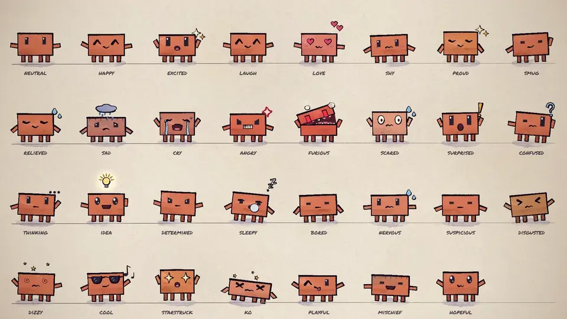

# Claude Animation Base

This is a small starter kit with code, instructions and assets for animating a character in [p5.js](https://p5js.org) and [p5.brush](https://github.com/acamposuribe/p5.brush) with Claude Opus 5.5. It's based on the code from the music video [I'm Upping My P(doom)](https://github.com/JohnHeibel/PDoomVideo) and an analysis of what the model did and didn't do well. I highly recommend playing around with your prompting: make it give you the storyboard before coding, give it very broad instructions, try being very specific, ask for subagents, and try a bunch of other fun ways of testing the model's capabilities. In my testing, it can do a lot with very little, but it's also quite accurate when you give it more requirements. Also try asking the model to swap out the character or make new emotions or costumes, give it your own reference images, and try many other fun things like that. I've found that the reasoning level corresponds to how "extravagant" and detail-oriented the model makes the scene. All test videos were generated with Opus 5.5 on xhigh reasoning in Claude Code.



## Make a video

Clone it, open it in Claude Code (or any coding agent) and ask for what you want:

> Read ANIMATION_GUIDE.md, then make a 15-second video of Clawd trying to catch a butterfly.

The model storyboards first, builds shot by shot, renders contact sheets to check its own work, and writes `out/video.mp4`. [ANIMATION_GUIDE.md](ANIMATION_GUIDE.md) holds the rules it follows: handmade, alive, one piece, no text, transitions always, something happens in every scene, and a solid medium of brush strokes, flat 2D and boiling linework. It also covers timing for the viewer and the core principles of character animation.

## Run it yourself

You need Node.js, Google Chrome and ffmpeg.

Without a dedicated GPU, p5.brush's watercolour fills make render times fairly slow, measured in seconds per frame. If you're running on integrated graphics, I recommend asking the model to avoid those fills and replace them with something else appropriate. (I love the look of the watercolours, though.)

```bash
npm install
node render.mjs --clip --out=out/video.mp4
```

That renders the 11-second demo in [src/scenes/demo.js](src/scenes/demo.js). Open [studio.html](studio.html) in Chrome to scrub through it. Add `?loop=emotions` or `?loop=views` to see the model sheets. If Chrome isn't in a standard location, pass `--chrome=<path>` or set `CHROME_PATH`.

On Linux, `render.mjs` starts Chrome with `--no-sandbox` (Ubuntu 23.10+ blocks Chrome's sandbox in headless use) and also finds a Chromium installed by Playwright. With no GPU at all, add `--soft-gl` to render WebGL in software: slow on watercolour fills, but it works. On a headless Linux machine with an NVIDIA GPU (a cloud or cluster node), add `--gpu-angle=gl-egl` (or `vulkan`); `node gpu_probe.mjs <chrome path>` shows which renderer each set of flags gets.

## What's here

| path | what it is |
|---|---|
| [ANIMATION_GUIDE.md](ANIMATION_GUIDE.md) | The rules, the workflow and the full API. Read it first. |
| [src/clawd.js](src/clawd.js) | Clawd: views, emotions, eyes, mouths, hats, emotes, dances |
| [src/core.js](src/core.js) | Painting, timing, motion helpers, camera, light, paper |
| [src/timeline.js](src/timeline.js) | Shots, loops and the brush-wipe transition |
| [src/config.js](src/config.js) | Length and tempo |
| [src/scenes/](src/scenes/) | Your video goes here (the demo is an example) |
| [render.mjs](render.mjs) | Headless renderer: contact sheets, frame strips, crops, stills, MP4 |
| [docs/](docs/) | Model sheets: [emotions](docs/emotions.jpg) (also [animated](docs/emotions.webp)) and [views, motion and hats](docs/views.jpg) |

---

## ANS · Day 01 / 28 品牌宣发片（本目录承载的实际交付）

在上游 starter kit 之上，本目录是 **ANS（AI Never Stops）Day 01 / 28 宣发片**的完整工程：p5.js + p5.brush 手绘水彩双主角、5 幕 + 落版、**45.9s @ 24fps / 1920×1080**。

**主角（V4.6 定稿，几何冻结）**：[src/ans_chars.js](src/ans_chars.js) —— 宽胖圆滚站立小恐龙 `dino`（薄荷绿 #9BE0C5）+ 主理人「我」`creator`（花冠 / 双横梁中空黑框眼镜 / ANS 白 T 恤）。该文件的几何与坐标是红线，任何返修不得改动。

**时间轴（单一可调点）**：[src/scenes/ans_day01.js](src/scenes/ans_day01.js) 顶部 `FILM_DUR / SHOT_T0 / SHOT_DUR / BEATS / SPAN`。口播边界由 [audio/day01_timeline.json](audio/day01_timeline.json) 的**实测语音**决定，画面节拍按各幕时长比例派生（改 TTS 时长只需改 `SHOT_T0`）。

| 项 | 值 |
|---|---|
| 幕边界（秒） | 0 / 7.027 / 14.760 / 23.786 / 29.143 / 43.700（落版段起）→ 45.900 |
| 帧数 | 1102 @ 24fps |
| 音乐相位 | [src/config.js](src/config.js) `MUSIC_DOWNBEAT = 1.1274`（= `music_grid.first_downbeat_t`，帧 27） |
| 节奏 | 124 BPM；装饰闪烁由帧对齐版 `pulseF()` 驱动，与 `music_grid.beat_frames` **前 30 拍逐帧误差 0** |
| 字幕 | 与口播**逐字一致**；12 条子句窗来自 `sub_clause_plan`（静音检测锚定）；切换为硬切 + 2 帧进场（任意帧不重叠） |

**语音 / 配乐 / 母带管线**：[audio/build_day01_audio.py](audio/build_day01_audio.py)（用法与凭证顺序见 [audio/README.md](audio/README.md)）
- 口播：火山引擎豆包 `seed-tts-2.0-expressive` / `zh_male_taocheng_uranus_bigtts`，`speech_rate 12` + 去播音腔导演提示；
- 配乐：`mgaudio` 引擎现做的 **124 BPM 燃曲**（10 轨 / Am–F–C–G / 六段与幕边界对齐；5 个切点的 hit+fill **按帧号反算采样点，0 帧误差**）；
- 母带：-14.00 LUFS (I) / LRA 5.5；**交付 MP4 需在编码侧预压**（本素材上 ffmpeg AAC 真峰值过冲约 2.5 dB，master 与 delivered 的 TP 必须分别验收，交付门禁 ≤ -1.0 dBTP）。

**复现**

```bash
npm install
node render.mjs --stills=2.6,11.0,18.0,30.8,44.6 --out=out/check   # 先静帧后动效（铁律）
node render.mjs --frames --workers=6                               # 1102 帧，可断点续跑
python audio/build_day01_audio.py                                  # 语音 + 配乐 + 母带
# 编码（bt709 / TV / yuv420p / faststart + 真峰值预压）见 audio/README.md
```

**权威守卫（防回退）**：`node scripts/check-day01-authority.mjs`（仓库根目录运行）
把本片已确认的决定写成机器断言，任何重构若触发失败即视为静默回退：
V4.6 造型字节冻结（ans_chars.js sha256）｜时长三处一致（config / 场景 / 时间轴）｜
音乐权威（124 BPM + 相位 1.1274 + **禁止回退到 lofi 库乐**）｜字幕与口播逐字相等（子句拼接逐字节）｜
字幕只绘制当前子句（结构上不可能重叠）｜未回退已否决的 78 BPM 方案。

**已知短板（盲审 backlog，尚未解决）**：转场仍非严格蒙版笔刷；镜头运动有限（五幕基本单一机位）；角色表演（眨眼 / 口型 / 多姿态）缺失。三轮独立盲审得分 6.29–6.93 / 10（目标线 8.5）——这三项属于**结构性改造**，不是调参项。
